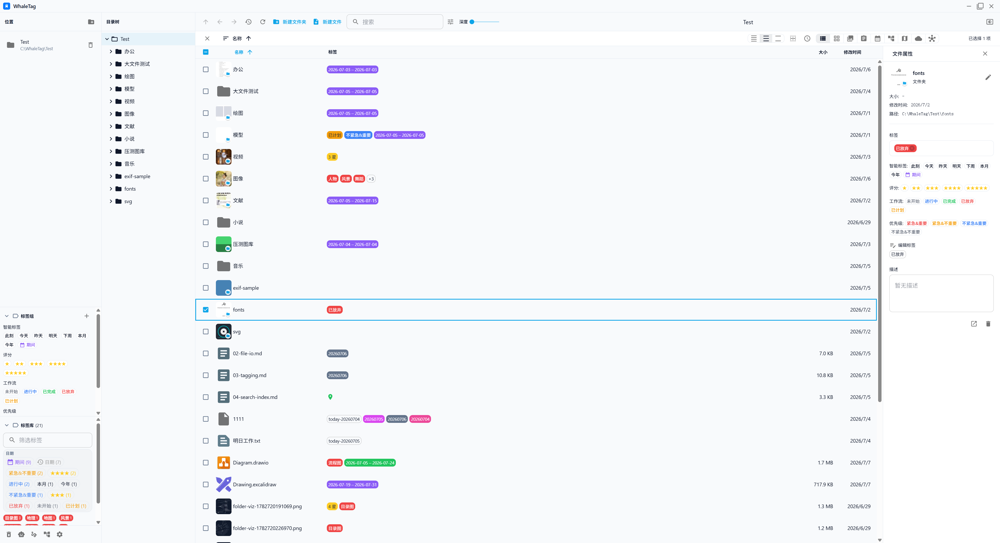
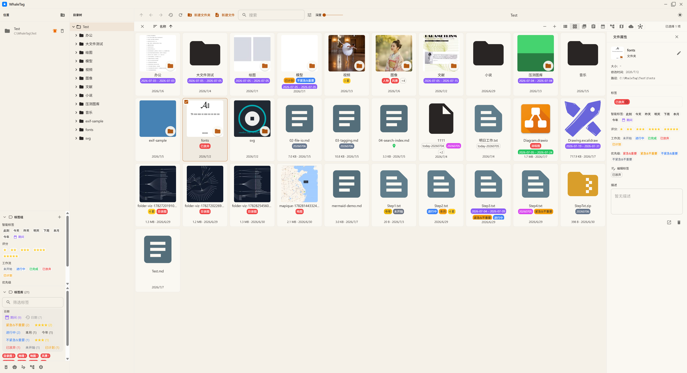
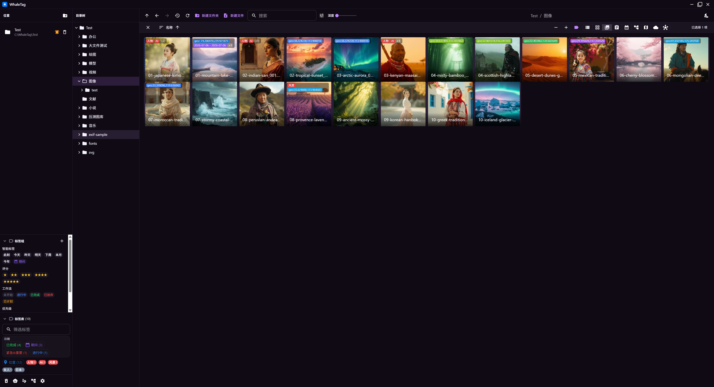
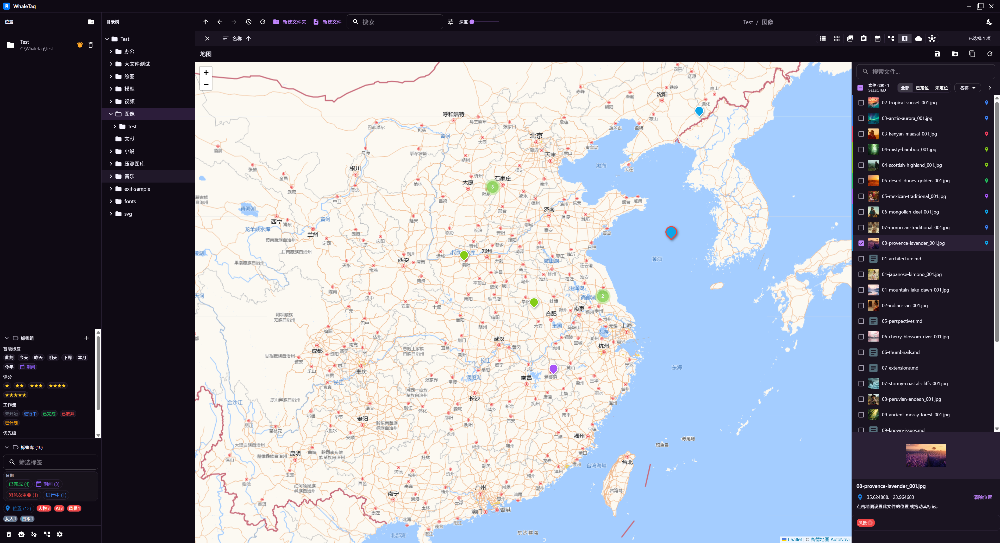
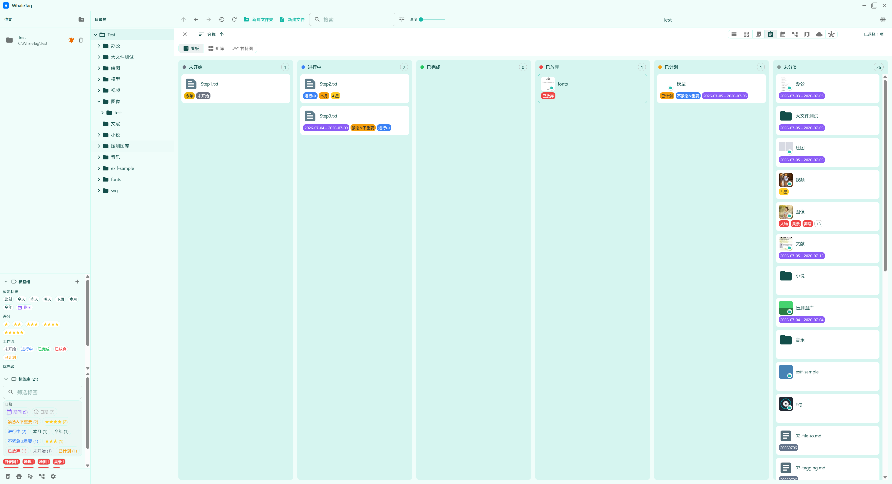
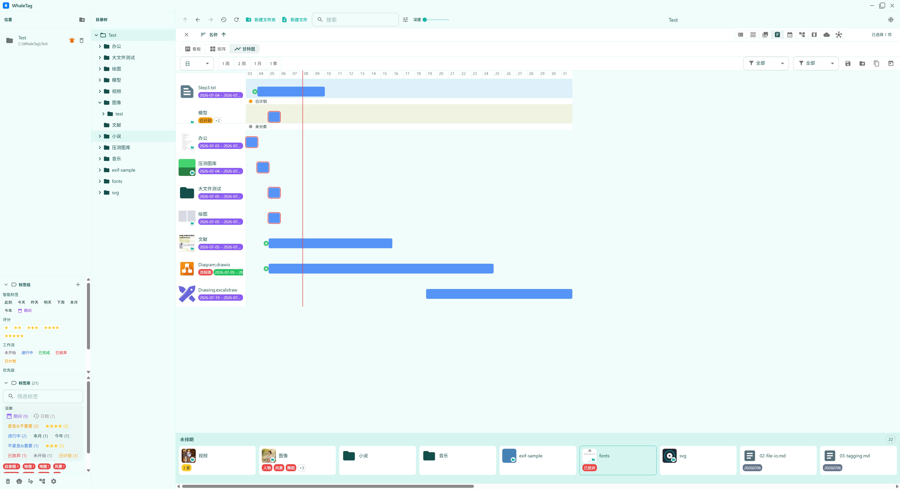
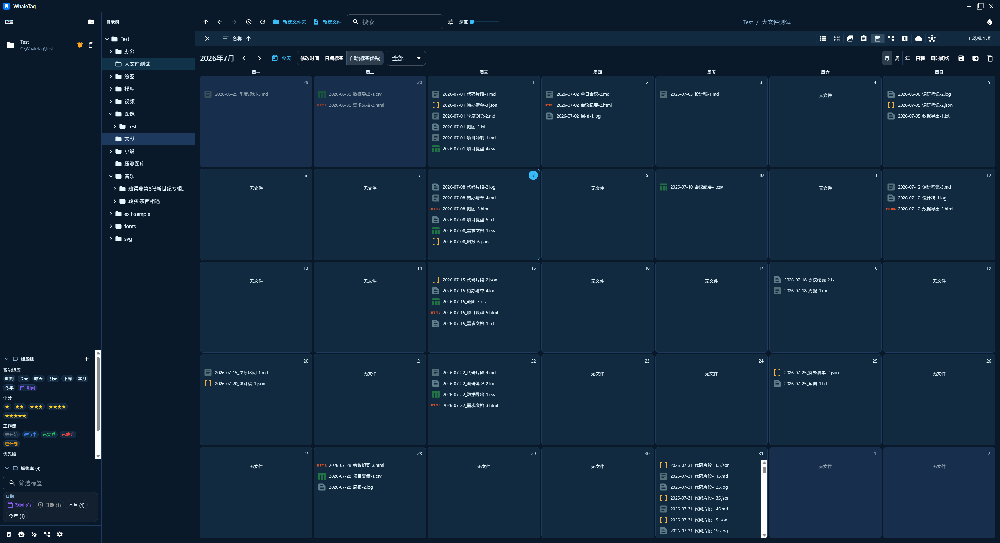
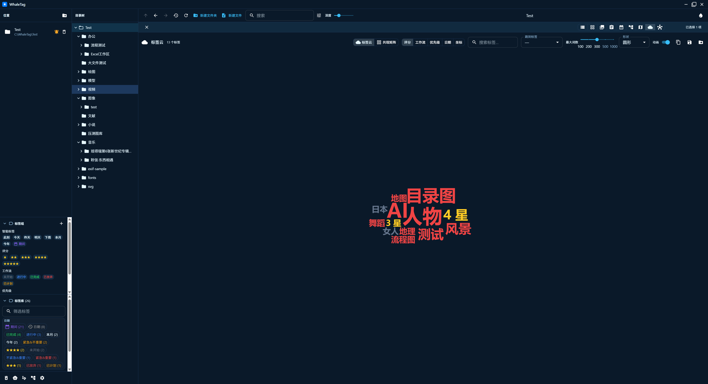
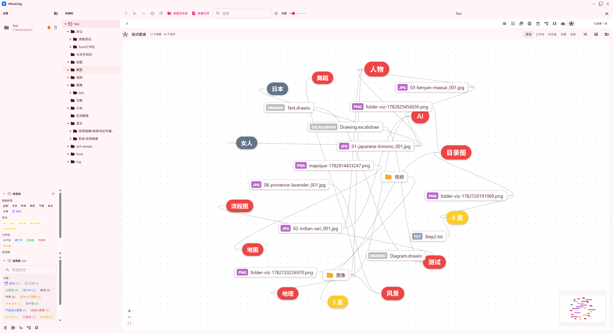

<p align="center">
  
</p>

<h1 align="center">WhaleTag / 鲸鱼标签 🐳</h1>

<p align="center">
  A local-first, offline, privacy-respecting desktop app for managing files and tagging them.<br/>
  本地优先、离线、隐私安全的文件管理与打标签桌面应用。<br/>
  Built on Electron + React + TypeScript (Electron React Boilerplate pattern). MIT licensed, all features free.
</p>

<p align="center">
  <b>English</b> · <a href="#-中文">中文</a>
</p>

---

## 📸 Screenshots

<!-- 占位:请把截图放到 docs/screenshots/ 下,文件名与下方一致即可自动显示。
     Placeholders — drop your images into docs/screenshots/ with the matching filenames. -->

<table>
  <tr>
    <td width="50%" align="center"><br/><sub>主界面 · Main file browser</sub></td>
    <td width="50%" align="center"><br/><sub>网格视角 · Grid</sub></td>
  </tr>
  <tr>
    <td width="50%" align="center"><br/><sub>画廊视角 · Gallery</sub></td>
    <td width="50%" align="center"><br/><sub>地图视角 · Mapique</sub></td>
  </tr>
  <tr>
    <td width="50%" align="center"><br/><sub>看板视角 · Kanban (Task)</sub></td>
    <td width="50%" align="center"><br/><sub>甘特图视角 · Gantt (Task)</sub></td>
  </tr>
  <tr>
    <td width="50%" align="center"><br/><sub>日历视角 · Calendar</sub></td>
    <td width="50%" align="center"><br/><sub>标签云视角 · Tag cloud</sub></td>
  </tr>
  <tr>
    <td width="50%" align="center"><br/><sub>知识图谱视角 · Knowledge graph</sub></td>
  </tr>
</table>

---

## English

**WhaleTag** is a local-first, offline, privacy-respecting file manager and tagging
tool. It is built from scratch on the **Electron React Boilerplate (ERB)** three-process
model — an independent, clean scaffold designed specifically for this project.

All data lives on your machine: no backend, no telemetry, no forced cloud. Metadata
(tags, perspectives, colors) is stored in a portable `.whale/` sidecar folder
alongside your files — **filenames and folder structure are never modified**, so the
whole library stays movable.

### Highlights

| Area | What it does |
|------|--------------|
| Locations | Local folder locations + read-only flags + LRU recent access |
| Browsing | Directory tree + breadcrumb + virtual scroll (list / grid / gallery), all 9 perspectives gated by a global `viewDepth` |
| Perspectives | list / grid / gallery / **task** (Kanban + Matrix + **Gantt**) / calendar (5 levels) / mapique / folderviz / tagcloud / knowledge-graph |
| Tagging | `wsd.json` aggregate sidecar; mutex families (rating 1–5 / workflow / quadrant / smart date ×7 / period); inline editor; 3-tier color fallback |
| Search | SQLite FTS5 over filenames + tags (trigram) + fulltext; advanced `SearchQuery` (10 fields); saved searches |
| Thumbnails | image / svg / video / pdf / font (5 kinds) + folder thumbnails; 39 fallback icons |
| Themes | **11 themes** (3 classic + 8 curated); `'system'` is always resolved before reaching MUI |
| Extensions | **8 built-in** viewers/editors (drawio, excalidraw, font, heic, html, image, json, text); revision history; Open With |
| AI / MCP | Optional loopback MCP server (**20 tools**) for search, tagging, smart-tag discovery, location setup, organization and packaging |

### Tech stack

| Layer | Technology |
|-------|------------|
| Desktop shell | **Electron** 42 |
| UI framework | **React** 18 |
| Language | **TypeScript** 5.9 (`jsx: react-jsx`, `module: CommonJS`) |
| UI components | **MUI** 9 + Emotion |
| State | **Redux** + react-redux (plain reducers, no Toolkit) |
| Persistence | **redux-persist** (synced through main-process IPC) |
| i18n | **i18next** + react-i18next (`common` namespace, en / zh / zh-TW / ja / ko) |
| Search index | **SQLite FTS5** (per-location `index.db`) |
| Build | **Webpack** 5 + ts-loader, multi-target via `webpack-merge` |
| Packaging | **electron-builder** |

### Architecture (ERB three-process model)

```
WhaleTag/
├── .erb/configs/              # Webpack configs (base + main + renderer, dev & prod)
├── resources/builder.json     # electron-builder config (target = release/app)
├── release/
│   ├── app/                   # the Electron app package electron-builder packs
│   │   └── package.json       #   productName + main = ./dist/main/main.js
│   └── build/                 # installer output (git-ignored)
└── src/
    ├── shared/                # pure logic shared across main ↔ renderer (types + pure fns)
    ├── main/                  # MAIN process — all FS IO, thumbnails, index, extensions
    │   ├── main.ts / preload.ts / ipc/ (domain handlers) / menu.ts
    └── renderer/              # RENDERER process (React UI, web target)
```

**Security model**: `contextIsolation: true`, `nodeIntegration: false`,
`sandbox: true`. The renderer only ever reaches the system through a curated
`window.whale` bridge exposed by preload; all file IO lives in the main process and
goes through `assertWithinAllowedRoot`. See [docs/13-security.md](docs/13-security.md).

### MCP for AI clients

WhaleTag can expose your opened locations to external AI clients through a local
**Streamable HTTP MCP server**. Its 20 tools cover search and text extraction, tags and
descriptions, smart-tag discovery, location setup, file organization and ZIP packaging.
The server is **disabled and read-only by default**, listens only on `127.0.0.1`, and
requires a Bearer token. File-level changes and adding a location require explicit
approval in WhaleTag; keep read-only enabled unless you need write operations.

1. Start WhaleTag and open **Settings → MCP Server**.
2. Enable the server, then copy the **actual endpoint** and token shown there. Keep
   read-only on for search/read-only agents, or turn it off only when writes are needed.
3. Add WhaleTag to a Streamable HTTP client such as ZCode or Claude Desktop:

```json
{
  "mcpServers": {
    "whaletag": {
      "type": "http",
      "url": "http://127.0.0.1:7433/mcp",
      "headers": {
        "Authorization": "Bearer <token copied from WhaleTag settings>"
      }
    }
  }
}
```

Port `7433` is the default; if it is occupied, WhaleTag selects a random free port, so
the endpoint in Settings is authoritative. WhaleTag must be running while the client
uses MCP. Reconnect the client after an app restart, and update the configuration if
the endpoint or token changes.

Agents should call `whale_roots` first to discover locations and index readiness, and
`whale_smart_tag_catalog` before semantic tagging. `whale_add_location` can add an
approved directory without restarting WhaleTag. See [docs/21-mcp.md](docs/21-mcp.md)
for the complete tool reference, approval rules and lifecycle details.

### Prerequisites

- **Node.js** ≥ 22.13 (`^22.13.0 || >=24.0.0`)
- **npm**

### Install

```bash
cd WhaleTag
npm install
npx electron-rebuild -f -o better-sqlite3
```

> The first install also downloads the Electron binary (large).
>
> `better-sqlite3` is a V8-bound (not N-API) addon: `npm install` fetches the
> prebuilt binary for the Node that ran npm, which Electron cannot load
> (`NODE_MODULE_VERSION` mismatch). Re-run the `electron-rebuild` line once per
> install and after every Electron upgrade; `npm run dev` and the test runner
> check it for you. See [docs/09-known-issues.md](docs/09-known-issues.md) §4.

### Run in development (hot reload)

```bash
npm run dev
```

This builds the main process once, watches it (`electronmon` auto-restarts Electron),
serves the renderer on `http://localhost:4002`, and launches Electron at the dev
server. The renderer reloads on every save; main-process changes restart Electron.

> Dev-launch hard requirement: ensure `ELECTRON_RUN_AS_NODE` is **unset** in your
> shell — a leftover value makes Electron degrade to a plain Node process and the
> main process won't start. See [docs/09-known-issues.md](docs/09-known-issues.md).

### Build for production

```bash
npm run build      # build main + extensions + renderer into release/app/dist
npm start          # run the production build
```

### Package an installer

```bash
npm run package        # current platform
npm run package:win    # Windows (nsis)
npm run package:mac    # macOS (dmg)
npm run package:linux  # Linux (AppImage)
```

Output lands in `release/build/`.

### Scripts

| Script | What it does |
|--------|--------------|
| `npm run dev` | Dev mode (main watch + renderer dev server + Electron) |
| `npm run build` | Production build (main + extensions + renderer) |
| `npm start` | Run the production build |
| `npm run package` | Build + electron-builder installer |
| `npm test` | Full test suite, parallel by default (`WHALE_TEST_CONCURRENCY=1` for serial); `pretest` runs `type-check` first |
| `npm run lint` | ESLint |
| `npm run type-check` | `tsc --noEmit` |
| `npm run clean` | Remove build output |

### Documentation

The `docs/` folder describes **current code behavior** per module (not changelogs).
Start at [plan.md](plan.md) — it is the entry index into `docs/01-*.md` … `docs/21-*.md`.
The design language (layout sizes, component specs, palette intent) lives in
[docs/10-ui.md §14](docs/10-ui.md).

### License

MIT. Third-party notices (e.g. bundled FFmpeg under GPL-3.0) live in [LICENSES/](LICENSES/).

---

## 🐳 中文

**WhaleTag** 是一个本地优先、离线、隐私安全的文件管理与打标签桌面应用。基于
**Electron React Boilerplate(ERB)** 的三进程模型从零自建,是专为该项目独立设计的干净脚手架。

所有数据都在本地:无后端、无遥测、无强制云。元数据(标签、视角、颜色)以可移植的
`.whale/` sidecar 目录形式与文件放在一起——**不改动文件名、不改变文件夹结构**,整个库
可以整体迁移。

### 核心能力

| 域 | 实现 |
|---|---|
| 位置管理 | 本地文件夹位置 + 只读标记 + LRU 最近访问;云存储(S3/WebDAV)不在范围 |
| 浏览 | 目录树 + 面包屑 + 虚拟滚动(list / grid / gallery),9 视角受全局 `viewDepth` 控制 |
| 视角 | list / grid / gallery / **task**(Kanban + Matrix + **Gantt**)/ calendar(5 档)/ mapique / folderviz / tagcloud / knowledge-graph |
| 标签 | `wsd.json` 聚合 sidecar;互斥家族(评分 1–5 / workflow / quadrant / smart date 7 种 / period);InlineTagInput 编辑;颜色三级回退 |
| 搜索 | SQLite FTS5 文件名 + 标签(trigram)+ 全文;高级查询 `SearchQuery` 10 字段;保存搜索 |
| 缩略图 | image / svg / video / pdf / font(5 种)+ 文件夹缩略图;39 类回退图标 |
| 主题 | **11 种**(3 经典 + 8 策划);`'system'` 必须先解析再流入 MUI |
| 扩展 | **8 个内置**(drawio / excalidraw / font / heic / html / image / json / text 查看器与编辑器);修订历史;右键 Open With |
| AI / MCP | 可选的本机 MCP 服务器(**20 个工具**),支持搜索、打标、智能标签目录、添加位置、整理与打包 |

### 技术栈

| 层 | 技术 |
|---|---|
| 桌面外壳 | **Electron** 42 |
| UI 框架 | **React** 18 |
| 语言 | **TypeScript** 5.9(`jsx: react-jsx`、`module: CommonJS`)|
| UI 组件 | **MUI** 9 + Emotion |
| 状态 | **Redux** + react-redux(纯 reducer,无 Toolkit)|
| 持久化 | **redux-persist**(走主进程同步 IPC)|
| 国际化 | **i18next** + react-i18next(`common` namespace,en / zh / zh-TW / ja / ko)|
| 搜索索引 | **SQLite FTS5**(每个位置一个 `index.db`)|
| 构建 | **Webpack** 5 + ts-loader,`webpack-merge` 多目标 |
| 打包 | **electron-builder** |

### 安全模型

`contextIsolation: true`、`nodeIntegration: false`、`sandbox: true`。渲染层只通过 preload
暴露的 `window.whale` 桥接触系统能力;所有文件 IO 在主进程,统一走 `assertWithinAllowedRoot`。
详见 [docs/13-security.md](docs/13-security.md)。

### 通过 MCP 接入 AI 客户端

WhaleTag 可以通过本机 **Streamable HTTP MCP 服务器**,把已打开的位置提供给外部 AI
客户端。20 个工具覆盖搜索与正文抽取、标签与描述、智能标签目录、添加位置、文件整理和
ZIP 打包;所有路径仍受 allowed roots 约束。服务器**默认关闭且只读**,只监听
`127.0.0.1`,并要求 Bearer token。文件级变更和添加位置需要在 WhaleTag 中明确批准;
只需要搜索和读取时请保持只读,确需修改元数据或文件时再关闭。

1. 启动 WhaleTag,打开 **设置 → MCP 服务器**。
2. 开启服务器,复制设置页显示的**实际 endpoint** 和 token。搜索/只读 agent 保持只读;
   确需写入时再关闭只读开关。
3. 在 ZCode、Claude Desktop 等 Streamable HTTP 客户端中添加:

```json
{
  "mcpServers": {
    "whaletag": {
      "type": "http",
      "url": "http://127.0.0.1:7433/mcp",
      "headers": {
        "Authorization": "Bearer <从 WhaleTag 设置页复制的 token>"
      }
    }
  }
}
```

`7433` 是默认端口;被占用时 WhaleTag 会选择随机空闲端口,因此以设置页显示的实际
endpoint 为准。客户端使用 MCP 期间 WhaleTag 必须保持运行;应用重启后需要重连,endpoint
或 token 变化后也要同步更新客户端配置。

Agent 应先调用 `whale_roots` 获取位置与索引状态,语义打标前调用
`whale_smart_tag_catalog`;经用户批准后,`whale_add_location` 无需重启 WhaleTag 即可
添加目录。完整工具说明、审批规则和生命周期见 [docs/21-mcp.md](docs/21-mcp.md)。

### 前置要求

- **Node.js** ≥ 22.13(`^22.13.0 || >=24.0.0`)
- **npm**

### 安装

```bash
cd WhaleTag
npm install
npx electron-rebuild -f -o better-sqlite3
```

> 首次安装会下载 Electron 二进制(体积较大)。
>
> `better-sqlite3` 是 V8/ABI 绑定模块(不是 N-API):`npm install` 装的是跑 npm 的那个
> Node 的 prebuilt 二进制,Electron 加载会报 `NODE_MODULE_VERSION` 不匹配。每次安装后
> (以及每次升级 Electron 后)重跑上面那行 `electron-rebuild`;`npm run dev` 与测试
> 运行器会自动检查。详见 [docs/09-known-issues.md](docs/09-known-issues.md) §4。

### 开发模式(热重载)

```bash
npm run dev
```

这会:构建一次主进程 → watch 主进程(`electronmon` 自动重启 Electron)→ 在
`http://localhost:4002` 启动渲染层 dev server → 启动 Electron 指向 dev server。
渲染层每次保存即热重载;主进程改动会重启 Electron。

> dev 启动硬约束:务必确保 shell 里 **`ELECTRON_RUN_AS_NODE` 已 unset**——残留值会让
> Electron 退化成纯 Node,主进程不启动。详见 [docs/09-known-issues.md](docs/09-known-issues.md)。

### 生产构建

```bash
npm run build      # 构建主进程 + 扩展 + 渲染层到 release/app/dist
npm start          # 运行生产构建
```

### 打包安装器

```bash
npm run package        # 当前平台
npm run package:win    # Windows (nsis)
npm run package:mac    # macOS (dmg)
npm run package:linux  # Linux (AppImage)
```

输出在 `release/build/`。

### 文档

`docs/` 下按模块描述**当前代码行为**(不是变更记录)。入口是 [plan.md](plan.md),
它索引了 `docs/01-*.md` … `docs/21-*.md` 各模块文档;设计语言(布局尺寸、组件规格、配色意图)在
[docs/10-ui.md §14](docs/10-ui.md)。

### 许可证

MIT。第三方声明(如内置的 FFmpeg,GPL-3.0)在 [LICENSES/](LICENSES/)。
